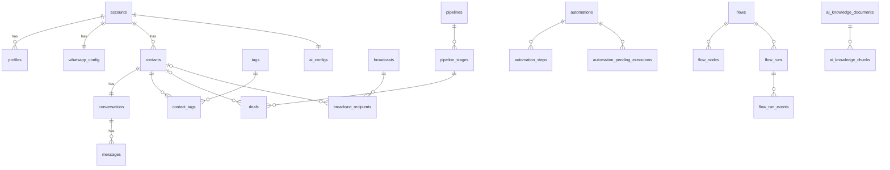

# System Overview — wacrm (WhatsApp Business CRM)

> Written 2026-09-25 from a read of the source, config, and all 42 migrations.
> Items marked **(unverified)** were not confirmed by running code.

---

## 1. One-line summary

A **self-hostable CRM for WhatsApp Business**. It gives a team a shared inbox on the official Meta Cloud API, plus contacts, sales pipelines, template broadcasts, no-code automations and chatbot flows, an AI reply assistant (you bring your own key), a public REST API, and an MCP server. It is aimed at small businesses and agencies that fork the template and host it themselves.

This repo is a fork of the upstream template [ArnasDon/wacrm](https://github.com/ArnasDon/wacrm), v0.8.x. The only local change is the latest commit, `first`, which added Vercel Speed Insights.

---

## 2. Tech stack

| Layer | What | Used for |
|---|---|---|
| Language | TypeScript (strict), SQL | Everything |
| Framework | **Next.js 16.3** (App Router, route handlers, `after()`), **React 19.2** | UI and the whole backend. There is no separate server. |
| Database / Auth / Storage | **Supabase**: Postgres 17, Auth, Storage, Realtime, RLS | All data. Email/password auth. Media buckets. Live inbox updates. |
| DB extensions | **pgvector** | Semantic search over the AI knowledge base. Optional; Postgres full-text search is the default. |
| Supabase libs | `@supabase/ssr`, `@supabase/supabase-js` | Cookie sessions, browser and server clients, service-role client |
| Messaging | **Meta WhatsApp Cloud API** (Graph `v21.0`) through raw `fetch` | Send and receive messages, templates, media |
| AI | Raw `fetch` to OpenAI (`/v1/chat/completions`, embeddings) and Anthropic (`/v1/messages`) | AI drafts, auto-reply, embeddings. No SDK. Keys are stored per account. |
| UI | Tailwind v4, shadcn (base-ui), lucide icons, sonner toasts | Styling and components |
| Charts / graphs | recharts, `@xyflow/react` + `@dagrejs/dagre`, `@dnd-kit` | Dashboard charts, visual flow builder, Kanban drag-and-drop |
| i18n | `next-intl` (catalogues in `messages/`: en, ko, pt, es) | One locale per deployment, chosen at build time |
| Voice notes | `opus-recorder` (encoder worker in `public/opus/`) | Recording audio in the inbox composer |
| Tests / lint | Vitest (86 `*.test.ts` files, node env), ESLint 9, Prettier | Unit tests, mostly in `src/lib` |
| CI | GitHub Actions: `ci.yml` (lint, typecheck, test, build) and `migrations.yml` (replays every migration on a clean Postgres using the Supabase CLI) | PR checks |
| Deploy | `Dockerfile` (multi-stage, `output: "standalone"`), `docker-compose.yml`. Upstream recommends Hostinger Managed Node; Vercel also works. | Hosting |
| Extra package | `mcp-server/` (`wacrm-mcp`, `@modelcontextprotocol/sdk`, zod) | Lets Claude, Cursor and similar tools drive the CRM through the REST API |

---

## 3. Folder map

```
.github/workflows/     CI (ci.yml) + migration replay check (migrations.yml)
docs/                  public-api.md, mcp.md, docker.md, multi-waba.md, whatsapp-connection-troubleshooting.md
messages/              i18n catalogues (en/es/ko/pt .json)
mcp-server/            Standalone MCP server package (stdio); talks to /api/v1 only
public/                Static assets + opus encoder worker
supabase/
  migrations/          001–042 SQL files — THE schema source of truth (apply in order)
  ci/verify-schema.sql Post-migration smoke assertions used by CI
  config.toml          Minimal; exists only for the CI job
src/
  middleware.ts        Session refresh + auth redirects (runs on every request)
  app/
    (auth)/            /login, /signup, /forgot-password
    (dashboard)/       Authed app: dashboard, inbox, contacts, pipelines, broadcasts,
                       automations, flows, agents, notifications, settings
                       dashboard-shell.tsx = sidebar + client-side auth guard
    join/[token]/      Accept a team invitation
    api/
      whatsapp/        webhook (Meta inbound), send, react, broadcast(+resume), templates, config, media proxy
      v1/              Public REST API (API-key auth)
      account/         Members, invitations, API keys, ownership transfer
      invitations/     Public peek/redeem of invite tokens
      ai/              Config, draft, playground, knowledge base, usage
      automations/     CRUD, manual engine trigger, cron drain
      flows/           CRUD, activate, runs, templates, cron timeout sweeper
      quick-replies/, contacts/[id]/tags
  lib/
    whatsapp/          Meta API client, send core, webhook signature, encryption, broadcast core/resume, templates
    automations/       Trigger→steps engine
    flows/             Stateful chatbot graph engine
    ai/                Providers, generation, auto-reply, knowledge (chunk/embed/retrieve)
    auth/              getCurrentAccount/requireRole, roles, invitations, API-key context
    api/v1/, api-keys/ Public API helpers, key generation/hashing/scopes
    webhooks/          Outbound webhook delivery, signing, SSRF guard
    contacts/          Dedupe, phone matching, tag events
    supabase/          Browser + server client factories
    rate-limit.ts      In-memory rate limiter
  hooks/               use-auth, use-realtime, use-broadcast-sending, use-presence, …
  components/          UI by feature (inbox, flows, settings, pipelines, ui/ = shadcn)
```

---

## 4. System design / architecture

It is one Next.js app. There are **no queues and no worker processes**. Background work runs in Next's `after()` or on externally pinged cron endpoints. Browsers read most data straight from Supabase under RLS. Server routes use either the user's RLS client or the **service-role** client, which bypasses RLS.

```mermaid
flowchart LR
  subgraph Browser
    UI[Dashboard UI<br/>React 19]
  end
  subgraph NextApp[Next.js app]
    MW[middleware.ts<br/>session refresh]
    API[Route handlers<br/>/api/*]
    WH[/api/whatsapp/webhook/]
    V1[/api/v1 public API/]
    CRON[/api/automations/cron<br/>/api/flows/cron/]
    ENG[Engines: flows, automations,<br/>AI auto-reply, outbound webhooks]
  end
  subgraph Supabase
    PG[(Postgres + RLS<br/>+ pgvector)]
    AUTH[Auth]
    ST[Storage buckets]
    RT[Realtime]
  end
  META[Meta WhatsApp<br/>Cloud API]
  LLM[OpenAI / Anthropic]
  EXT[Customer webhook<br/>endpoints]
  MCP[mcp-server<br/>stdio] --> V1
  SCHED[External scheduler] -->|x-cron-secret| CRON

  UI -->|anon key, RLS| PG
  UI --> AUTH
  RT -->|live inserts| UI
  UI -->|fetch| API
  API --> PG
  API -->|send| META
  META -->|HMAC-signed POST| WH
  WH -->|after()| ENG
  ENG --> PG
  ENG --> META
  ENG --> LLM
  ENG --> EXT
  ENG --> ST
  V1 -->|service role| PG
  CRON --> ENG
```

Key points:
- **Tenancy:** every row has an `account_id`. RLS uses `is_account_member(account_id, min_role)`. Roles, from highest to lowest: owner > admin > agent > viewer.
- **Secrets at rest:** WhatsApp access tokens, verify tokens, AI keys and webhook secrets are encrypted with AES-256-GCM using `ENCRYPTION_KEY` (`src/lib/whatsapp/encryption.ts`).
- **Precedence for an inbound message:** Flows run first. If a flow does not consume the message, automations run, then the AI auto-reply.

---

## 5. How it works — core flows

### A. A customer sends a WhatsApp message (inbound)

1. Meta POSTs to `src/app/api/whatsapp/webhook/route.ts`.
2. `verifyMetaWebhookSignature` (`lib/whatsapp/webhook-signature.ts`) checks an HMAC-SHA256 against `META_APP_SECRET`. A bad signature gets a 401.
3. The route returns **200 immediately**. The real work runs in `after(() => processWebhook(body))`, with a 60s `maxDuration`.
4. `processWebhook` routes each change:
   - status updates go to `handleStatusUpdate`
   - template events go to `handleTemplateWebhookChange`
   - messages look up `whatsapp_config` by `phone_number_id`, then call `processMessage`.
5. `processMessage` does the following, in order:
   - `findOrCreateContact` dedupes by WhatsApp user id, then by phone (`lib/contacts/dedupe.ts`).
   - `findOrCreateConversation` picks the oldest thread for that contact.
   - `parseMessageContent` handles media by downloading it and mirroring it to the `chat-media` bucket (`mirror-inbound-media.ts`).
   - It **upserts** into `messages` on `(conversation_id, message_id)`. This is the idempotency point: a replayed delivery stops here.
   - RPC `bump_conversation_on_inbound` updates unread count and last message. The conversation is reopened if it was closed, and a broadcast reply is flagged if there was one.
   - `dispatchInboundToFlows` runs, then `runAutomationsForTrigger` (skipped for some triggers if a flow consumed the message), then `dispatchInboundToAiReply`, then `dispatchWebhookEvent('message.received')`.
6. The inbox UI receives the new row through Supabase Realtime (`hooks/use-realtime.ts`).

### B. An agent replies from the inbox (outbound)

1. `components/inbox/message-thread.tsx` shows an optimistic bubble and calls `POST /api/whatsapp/send`.
2. `app/api/whatsapp/send/route.ts` checks `requireRole('agent')`, applies `checkRateLimit` (60/min), validates the request, and resolves the conversation.
3. `sendMessageToConversation` (`lib/whatsapp/send-message.ts`):
   - decrypts the token
   - calls `sendTextMessage` / `sendTemplateMessage` / `sendMediaMessage` / … (`lib/whatsapp/meta-api.ts`), which POST to `graph.facebook.com/v21.0/{phone_number_id}/messages`
   - retries with phone-number variants if Meta rejects the recipient
   - inserts into `messages`, updates the conversation, and pauses any active flow run.
4. Delivered and read receipts arrive later through the webhook (`handleStatusUpdate`).

### C. A user signs up, then invites a teammate

1. `app/(auth)/signup/page.tsx` calls `supabase.auth.signUp`.
2. The DB trigger `on_auth_user_created` runs `handle_new_user()` (migration 017), which creates an `accounts` row and an owner `profiles` row.
3. On every request, `middleware.ts` refreshes the session and redirects unauthenticated users to `/login`.
4. Server code calls `getCurrentAccount()` / `requireRole()` (`lib/auth/account.ts`).
5. An admin POSTs `/api/account/invitations`. This generates a token (`lib/auth/invitations.ts`), stores only its SHA-256 hash, and returns a `/join/<token>` link.
6. The invitee opens `app/join/[token]/page.tsx`. The page calls `/api/invitations/[token]/peek` and then `/redeem`, which runs RPC `redeem_invitation`. That moves the invitee's profile into the inviter's account and deletes their empty personal account.

### D. Broadcasts (short version)

- **From the dashboard:** the send loop runs **in the browser tab**. `hooks/use-broadcast-sending.ts` inserts the broadcast and recipient rows, then calls `POST /api/whatsapp/broadcast` in batches of 10, with 1s pauses between batches.
- **If the tab closes:** the rest stay `pending` until someone clicks **Resume**. That calls `api/whatsapp/broadcast/[id]/resume`, which takes a lock, then runs `after()` + `deliverBroadcast` for up to 1000 recipients per call.
- **Via the public API:** `POST /api/v1/broadcasts` uses the RPC `create_broadcast_with_recipients`, then `after()`.
- **Counters:** the DB trigger keeps `broadcasts.*_count` up to date from recipient status changes.

---

## 6. Data model

The schema is defined only by `supabase/migrations/*.sql`. There is no ORM.

**Tenancy:** `accounts` ←1:N `profiles` (1:1 with `auth.users`, which carries `account_role`), plus `account_invitations`, `api_keys`, `webhook_endpoints`, `member_presence` and `notifications`.

**CRM**
- `contacts`: unique on `(account_id, phone_normalized)` and on `(account_id, wa_user_id)`
- `tags` ↔ `contacts` through `contact_tags`
- `custom_fields` and `contact_custom_values`, `contact_notes`
- `pipelines` → `pipeline_stages` → `deals`. A deal can link to a contact, a conversation, and an assignee.

**Messaging**
- `whatsapp_config`: one per account; the token is encrypted
- `conversations`: one per contact
- `messages`: unique on `(conversation_id, wamid)`
- `message_reactions`, `message_templates`, `quick_replies`

**Broadcasts:** `broadcasts` → `broadcast_recipients` (holds wamid, per-recipient status, frozen `template_params`).

**Automations:** `automations` → `automation_steps` (a tree of yes/no branches), plus `automation_logs` and `automation_pending_executions` (the queue for wait steps).

**Flows:** `flows` → `flow_nodes` (edges are stored inside each node's `config`) → `flow_runs` (at most one active run per contact) → `flow_run_events`.

**AI:** `ai_configs` (one per account), `ai_knowledge_documents` → `ai_knowledge_chunks` (`tsvector` + `vector(1536)`), `ai_usage_log`.

**Storage buckets:** `avatars`, `flow-media`, `chat-media`. All three are **public-read**.



---

## 7. Running locally

**You need:** Node ≥ 20, a Supabase project (hosted, or local via the Supabase CLI), and a Meta developer app with a WhatsApp Business number if you want real messaging.

1. `npm install`. `node_modules` is not currently installed in this checkout.
2. **Apply the database schema.** Run every file in `supabase/migrations/` **in filename order** against your Supabase project, in the SQL editor or with the Supabase CLI. The files are idempotent. For a local database:
   ```
   supabase start
   supabase db reset --local
   ```
3. `cp .env.local.example .env.local` and fill it in.

   | Variable | Required? | Notes |
   |---|---|---|
   | `NEXT_PUBLIC_SUPABASE_URL`, `NEXT_PUBLIC_SUPABASE_ANON_KEY` | yes | Inlined at **build time** |
   | `SUPABASE_SERVICE_ROLE_KEY` | yes | Server only. Bypasses RLS. |
   | `ENCRYPTION_KEY` | yes | 64 hex chars. Generate with `node -e "console.log(require('crypto').randomBytes(32).toString('hex'))"` |
   | `META_APP_SECRET` | yes | Needed for webhook HMAC checks. Accepts a comma-separated list. |
   | `NEXT_PUBLIC_SITE_URL`, `NEXT_PUBLIC_APP_LOCALE` | recommended | |
   | `AUTOMATION_CRON_SECRET` | optional | Needed if you use automation Wait steps or flow timeouts |
   | `META_APP_ID` | optional | Needed for image-header templates |
   | `WHATSAPP_TEMPLATES_DRY_RUN=true` | optional | Handy in dev without a real WABA account |
   | `ALLOWED_INVITE_HOSTS`, `AI_REQUEST_TIMEOUT_MS`, `AI_CONTEXT_MESSAGE_LIMIT`, `ALLOWED_DEV_ORIGINS` | optional | |

4. Start and check:
   ```
   npm run dev        # dev server on http://localhost:3000
   npm test           # vitest
   npm run lint
   npm run typecheck
   npm run build
   ```
   Or use Docker: `docker compose up --build` (see `docs/docker.md`).
5. **To receive webhooks locally**, expose the dev server over a tunnel such as ngrok or cloudflared. Those hosts are already allowed in `next.config.ts`. Point the Meta webhook at `https://<tunnel>/api/whatsapp/webhook`. The verify token is the one you save in Settings → WhatsApp.
6. **Cron:** nothing is scheduled for you. If you use Wait steps or flow timeouts, hit these every minute or so with the header `x-cron-secret: $AUTOMATION_CRON_SECRET`:
   - `GET /api/automations/cron`
   - `GET /api/flows/cron`
7. **MCP server (optional):**
   ```
   cd mcp-server && npm install && npm run build
   ```
   It needs `WACRM_BASE_URL` and `WACRM_API_KEY`, the key created in Settings → API keys.

---

## 8. Gotchas

**Setup and docs**
- **Migrations are applied by hand.** There is no automatic migration on deploy. After pulling an update, read the CHANGELOG for **"Migration required"** notes. Migration 031 was once renamed to 034, so always go by filename order.
- **Broken doc links:** `.env.local.example` points to `docs/automations-and-cron.md` and CONTRIBUTING points to `docs/README.md`. Neither file exists. The full docs live in a separate repo (wacrm.tech).
- **AGENTS.md says to read `node_modules/next/dist/docs/`.** That folder only exists after `npm install`, and even then **(unverified)** that Next ships it.
- **Changing `NEXT_PUBLIC_*` requires a rebuild**, including the locale.
- **Rotating `ENCRYPTION_KEY`** makes every stored WhatsApp token, AI key and webhook secret unreadable. Everyone has to reconnect.
- **The version is inconsistent:** `package.json` says 0.8.0, while CHANGELOG's latest entry is 0.8.1.

**Architecture risks**
- **The service-role client is everywhere:** the webhook, the engines, `/api/v1`, and some flow and quick-reply routes. Those paths bypass RLS, so each query must filter by `account_id` by hand. Keep doing this in any new endpoint.
  - `supabaseAdmin()` is copy-pasted three times (`lib/{flows,automations,ai}/admin-client.ts`).
- **The rate limiter is in memory, per process** (`lib/rate-limit.ts`). It effectively does nothing on serverless or multi-instance deploys.
- **No job queue.** All inbound fan-out (flows, automations, LLM calls, outbound webhooks) runs one step after another inside a 60s `after()`. A slow LLM call can cut off later steps.
- **Outbound webhooks** get a single attempt with no retry. An endpoint is auto-disabled after 15 failures in a row.

**Messaging**
- **Dashboard broadcasts run in the browser tab.** Closing the tab stalls the send. Clicking **Resume** while the original tab is still sending can **double-send** to pending recipients, because the wizard never takes the delivery lock.
- **The 24-hour customer-service window is enforced only in the UI.** The API, automations and flows will attempt free-form messages anyway. Meta rejects them, and the app returns a 502.
- **Status updates can move backwards.** `messages.status` has no ordering guard, so a late "delivered" can overwrite "read". Broadcast recipients do have a guard.
- **Inbound messages are silently dropped** (only logged) if zero or several `whatsapp_config` rows match the `phone_number_id`.
- **`chat-media`, `flow-media` and `avatars` are public buckets.** Anyone with the URL can view customer attachments.

**Auth**
- **`middleware.ts` protects only some pages.** `/flows`, `/agents` and `/notifications` are missing from its `protectedPaths` list. They fall back to a client-side redirect in `dashboard-shell.tsx`. Data stays protected by RLS.
  - Next 16 prefers `proxy.ts` over `middleware.ts`. Whether the old name is deprecated or warns was **(unverified)**.
- **Signup can leave a user with no account.** `handle_new_user()` swallows errors (`EXCEPTION WHEN OTHERS`). If account creation fails, the user exists but gets a "Profile is not linked to an account" error.
- **Make sure migrations 032 and 034 are applied.** They fix a cross-account knowledge-base read and a role self-promotion hole (advisory GHSA-fg5p-2qc3-jmxr).

**Automations and flows**
- **Two automation triggers look dead:** `time_based` and `conversation_assigned` are in the builder, but I found no code that fires them.
- **An automation step can get stuck.** If the process dies mid-run, the `automation_pending_executions` row stays `running` forever.
- **Without the flows cron,** an abandoned flow run blocks that contact from new flows indefinitely.
- **A stale comment in `lib/flows/engine.ts`** says flows are beta-gated. The engine does no such check.

**Local changes and leftovers**
- **Local commit `first`** added `@vercel/speed-insights` to `app/layout.tsx`. It only reports when the app is deployed on Vercel; on Hostinger or Docker it does nothing.
- **The root `tsconfig.json` includes `mcp-server/**`,** whose dependencies are not in the root `package.json`. It is **(unverified)** whether this breaks the root `typecheck`.
- **Some schema pieces are still scoped by user instead of account:** the `message_templates` unique index, the `avatars` bucket, and the legacy `profiles.role` column. There is a `TODO(account-sharing)` in `api/whatsapp/templates/submit/route.ts`.
